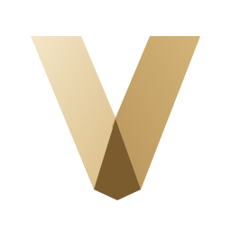

# PdfCraft app icon



**Mark:** a folded-ribbon "V" in gold, on a transparent background. The left arm runs cream to gold,
the right arm gold to darker gold, and the fold at the point is bronze.

**Palette:**

| Colour | Hex | Used for |
|---|---|---|
| Navy | `#163A5C` | brand colour (not used in the icon files) |
| Gold | `#C9A96E` | the V (gradients `#D4B47A` to `#B8955A`, `#F3E6C8` to `#D9BC85`) |
| Cream | `#F3E6C8` | the V's light arm; the document icon's page fold |
| Bronze | `#7A5C2E` | the V's fold; the document icon's small-frame page outline |

**Canvas:** `viewBox="0 0 256 256"`, no live text. Windows and Linux icons use the canvas as drawn. macOS
icons put it on Apple's grid (an 824 px body centred on a transparent 1024 px canvas).

**Document icon:** a cream page (`#FBF7EE`, outline `#E4DCC8`) with a folded top-right corner and the
same V, optically centred. At 16, 24 and 32 px the outline becomes bronze `#7A5C2E` and thicker, so the
page edge shows on a white background; larger frames keep the master as drawn.

**Provenance:** original work made for PdfCraft by the project owner.
Licence: [LICENSE.txt](LICENSE.txt) (app icon) and [LICENSE-document.txt](LICENSE-document.txt) (document
icon), both `MIT OR Apache-2.0`, like the repo.

## Files

| File | What it is |
|---|---|
| `v-mark.svg` | the app icon master; every app PNG, `.ico` and `.icns` is rendered from it |
| `v-file.svg` | the Windows PDF file icon master |
| `pdfcraft-1024.png` | 1024 px on Apple's grid; also the runtime Dock icon on macOS |
| `pdfcraft.icns` | macOS icon (16–1024 px, PNG entries) |
| `pdfcraft.ico` | Windows icon (16, 24, 32, 48, 64, 128, 256 px), embedded in `vhnoterpdf.exe` by `apps/pdfcraft/build.rs` |
| `pdfcraft-document.ico` | Windows PDF file icon (same sizes), embedded as resource 2 in `vhnoterpdf.exe` |
| `hicolor/<n>x<n>/apps/ai.storyteller.pdfcraft.png` | Linux hicolor theme, 16–512 px; the 256 px one is the runtime icon on Windows and Linux, the 128 px one the update prompt's |
| `hicolor/scalable/apps/ai.storyteller.pdfcraft.svg` | Linux scalable icon (copy of `v-mark.svg`) |
| `pdfcraft.svg` | the former app icon (a lion); kept only as the source of the macOS DMG window background |

Where it shows: `apps/pdfcraft/src/main.rs` sets the window icon (Dock, taskbar, Alt-Tab, launcher) and the
Wayland app id `ai.storyteller.pdfcraft`; `packaging/linux/ai.storyteller.pdfcraft.desktop` names the
hicolor icon.

Windows PDF files use resource 2 (`"vhnoterpdf.exe",-2`) when PdfCraft is chosen as the default
reader; the app keeps resource 1. Both icons are embedded, requiring no runtime sidecar. This
provides a file type icon; first-page thumbnails still need a thumbnail provider.

## Regenerate

```sh
packaging/icons.sh        # needs resvg and python3 (stdlib); writes every file above, the .icns included
cargo xtask assets        # then update the sha256 values in ATTRIBUTION.toml and run with --write
```
